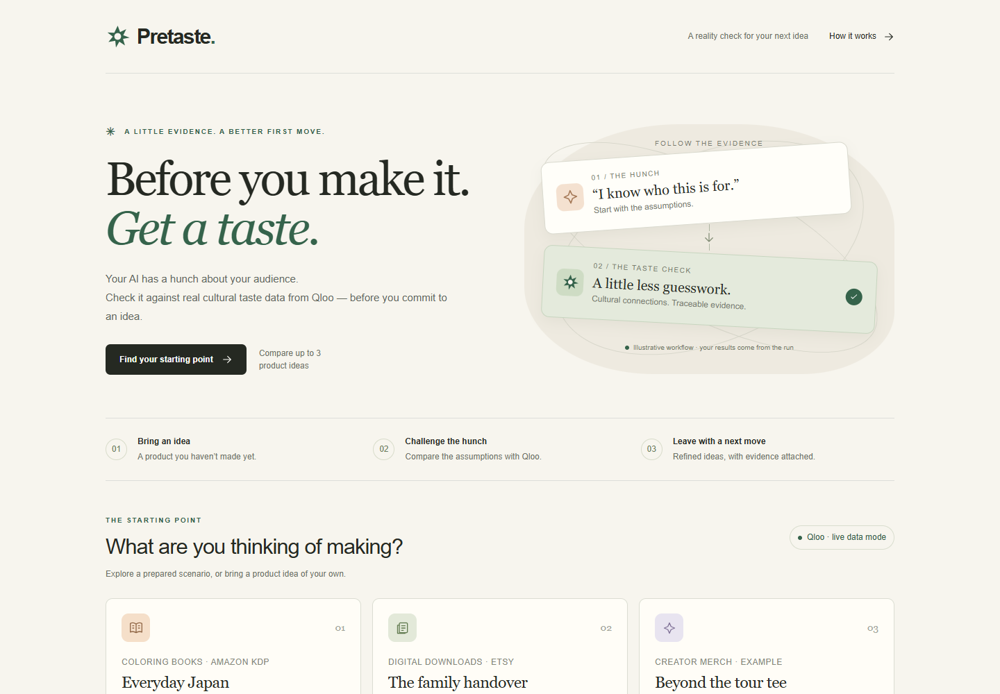

# Pretaste

**Your agent guessed. Qloo checked.**

Pretaste helps makers challenge the audience assumptions behind a product idea before making it.
An agent drafts up to three ideas and their cultural comparables, checks the assumptions against
Qloo's taste data, and produces a next experiment and a revised draft with traceable evidence.
Taste affinity and demographic skew are relative signals about comparable audiences, **not sales
forecasts, buyer counts, conversion rates, or proof of demand**.



## Run

Requires Node.js 20+.

```bash
npm install
cp .env.example .env.local   # optional; every value may stay empty
npm run dev                  # http://localhost:3000
```

Other scripts:

```bash
npm run build        # production build
npm run lint         # ESLint
npm run typecheck    # TypeScript (generates Next route types first)
npm run check-leaks  # scan the repo for keys and Qloo-response-like data
npm test             # regression tests (src/lib/*.test.ts, mcp/*.test.mjs; Node test runner, no keys or network)
```

Run the full pipeline against a server and save the result (no keys needed in mock/offline mode):

```bash
node scripts/pretaste-cli.mjs http://localhost:3000 --scenario coloring-japan --out .cache/runs/coloring.json
node scripts/evaluate.mjs    # Pretaste vs the same model alone on the dev inputs; calls the deployed app and the claude CLI; method in the file header
```

Run files and evaluation results contain Qloo response values, so they stay in `.cache/` (git-ignored) and are not published.

Enable the pre-commit guard once per clone:

```bash
git config core.hooksPath .githooks
```

For isolated local checkouts with linked dependencies outside the project, set
`PRETASTE_WORKSPACE_ROOT` to the smallest common parent. Normal installs do not need it.

## MCP

Agents can call Pretaste before they make something. `mcp/pretaste-mcp.mjs` is a stdio MCP server with no dependencies and one tool, `pretaste_check`. It returns the verdicts, the ranking, the rewritten listing and a next step. Setup, schema and example: [mcp/README.md](mcp/README.md).

```bash
claude mcp add pretaste -- node /path/to/pretaste/mcp/pretaste-mcp.mjs
```

## Environment variables

Put these in `.env.local` (git-ignored). Never commit keys.

| Name | Purpose |
| --- | --- |
| `QLOO_API_KEY` | Qloo hackathon API key. Sent only as the `X-Api-Key` header, only to `https://hackathon.api.qloo.com`, GET only. Empty = mock mode. |
| `QLOO_MODE` | Set to `mock` to force mock mode even when a key is present. |
| `PRETASTE_ANTHROPIC_API_KEY` | Anthropic key for Pretaste. `ANTHROPIC_API_KEY` is intentionally **not** read. Empty = offline mode. |
| `PRETASTE_MODEL` | Model for every LLM step (default `claude-sonnet-5-5`). `PRETASTE_MODEL_PLANNER` / `PRETASTE_MODEL_WRITER` override per role. |
| `PRETASTE_CACHE` | `file` stores live Qloo responses in `.cache/qloo` (git-ignored). Default: in-memory. |
| `PRETASTE_LLM_CALLS_PER_DAY` | Daily budget of live LLM calls (default `400`, `0` = none), counted by each server instance on its own, not shared across instances; the monthly spend cap on the Anthropic account is the hard ceiling. Past it, the prepared scenarios use their prepared text and say so, while the Qloo checks keep running; a custom idea still runs: its draft is the idea as written (no guessed audience, so every verdict says it cannot be checked), and only titles the maker put in double quotes are looked up in Qloo. Re-sending the same step of a run returns the saved answer and uses no new calls. |

## Mock and offline modes

Pretaste runs end to end with no keys at all.

- **Mock (no `QLOO_API_KEY`, or `QLOO_MODE=mock`)**: every Qloo call is answered by a local,
  deterministic generator (`src/lib/qloo/mock.ts`). Names are prefixed `[SYN]`, ids start with `SYN-`,
  and the screen shows **"SYNTHETIC — not Qloo data"**. None of these numbers come from Qloo.
- **Offline (no `PRETASTE_ANTHROPIC_API_KEY`)**: the agent's text (the blind guess, the comparables,
  the grounded listing) comes from prepared fixtures in `src/fixtures/scenarios.ts`, and the screen
  shows an "Offline" notice. Verdicts and rankings are always computed by fixed rules
  (`src/lib/rules.ts`) from the recorded calls. The prepared text covers the first idea only: when
  the ranking puts another idea in focus, the after listing repeats the before listing and is marked
  "model unavailable".

## Screens

1. **Assumptions** — checkable findings first; assumptions the data cannot establish remain visibly separate.
2. **Before & after** — drafts for the same product, with a "Qloo off" comparison and the claims behind the rewrite.
3. **Ideas ranked** — research priority from a fixed formula (affinity, trend, found, overlap), with coverage and the calculation available to inspect. The first card says in how many nearby weightings (each weight moved by 0.1) it stays first. This is not a probability of success.
4. **Audience** — cultural neighbours, relative age and gender skew, approximate US regional affinity, and creative direction labelled as interpretation. These are signals from the comparables, not measured customers of the proposed product.
5. **Evidence** — links open the matching recorded call, with claim checks, agent decisions and technical details available on demand.

Each listing has a copy button, and the whole run can be saved as Markdown. Runs show elapsed
time and actual pipeline progress, can be cancelled, and can be restarted after an interruption.
Keyboard navigation, labelled fields and mobile layouts are supported.

Each page start (including **Try again**) and CLI run sends a fresh UUID in the step-0
`Idempotency-Key` header. Re-sending the same exact body with that UUID reuses its saved answer
for 10 minutes; a new UUID starts a fresh run, including after an earlier run recorded failures.
API callers may omit the header for the legacy same-body replay behavior; malformed UUIDs are
rejected before any model or Qloo calls. Later steps still require the signed state in order.
Replay deduplication is bounded, in-memory and per server instance, so it is not a cross-instance
or durable exactly-once guarantee. A new UUID avoids matching an earlier attempt on any instance.

## Evidence safeguards

- Search rejects unrelated titles, ambiguous identities and unverified rephrases. Conservative
  title normalization and a small, explicit alias list do not silently substitute another work.
  Two narrow forms also count as the same title, each with a warning on the call: the first book of a
  labelled series ("Title (Series, #1)") and a title with a subtitle that has no sequel marker
  ("Title: Subtitle"; seasons, parts, volumes, arcs and films are refused).
  Search text is limited to 100 UTF-16 code units after an observed API validation rejection; returned titles are still checked against the complete original title.
- Numeric claims must match the cited subject and metric. Affinity cannot become a purchase
  percentage; female and male signals cannot be exchanged. Unsupported measurements are removed.
- A partial failure in the comparison data holds all recommendations rather than ranking ideas
  on unequal coverage. Available signals remain inspectable, and failed calls are recorded.
- Product specifications are distinct from audience measurements. Price claims must match the
  maker's input; cultural data cannot validate a price or guarantee product demand.

The aesthetic guess is checked against the style and topic tags Qloo ties to fans of the
comparables (`/v2/insights` with `filter.type=urn:tag`, two calls): at least half the guessed looks
found is Supported, none found is Challenged, anything between is Not established. A guessed look
matches a tag by whole words or a shared stem of 5+ letters; a one-word tag never matches a longer
guess. Life stage is not validated: Qloo does not report it. Ideas with no taste signal at all are
held as "Not ranked" instead of receiving a low score. Regional
labels use an approximate US map. Validate the product, creative direction and price with real
customers before investing in production.

## Access

There is no login and no hard usage cap: anyone can run the prepared scenarios or their own idea.
See `PRETASTE_LLM_CALLS_PER_DAY` for how cost is kept in check without blocking.

## License

MIT — see [LICENSE](./LICENSE).
